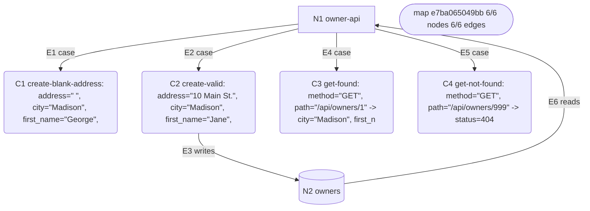

# DRIFT Real-World PR Showcase — Spring Petclinic REST

This fork demonstrates **[DRIFT Free (`v0.11.0`)](https://github.com/rad-ox/drift/releases/tag/v0.11.0)** running in live GitHub Actions pull-request checks on **[Spring Petclinic REST](https://github.com/spring-petclinic/spring-petclinic-rest)** (upstream base `220f4ba8e92c`).

- **DRIFT project & release:** [rad-ox/drift (`v0.11.0`)](https://github.com/rad-ox/drift)
- **Important:** All demo PRs target this fork's `main` branch only — never upstream.

## What `v0.11.0` Enforces Here

- **Hardened observed policy (`.drift/config.toml`):** `proof = "verified"` + `require_observations = true` (`core@1`, approved by `rad-ox`).
- **Strict input binding (`drift-junit:0.11.0`):** `@DriftCase(..., strictWhen = true)` and `DRIFT_STRICT_WHEN=1` verify that tests actually consume contract `when.*` inputs and emit real `drift.observation/1` payload + write-frame records via `c.verify(...)` and `c.checkFrame(...)`.
- **Single-command gate + independent parity check:**
  ```bash
  DRIFT_STRICT_WHEN=1 drift run --events target/drift-events --gate -- \
    mvn -q -B test -Dtest=OwnerApiDriftTest

  drift gate .drift/contracts --events target/drift-events --json > gate.json
  python3 verifier/drift_verify.py .drift/contracts \
    --config .drift/config.toml \
    --events target/drift-events \
    --compare-gate gate.json --json
  ```

## Contract Map (`drift map .drift/contracts/owner-api.toml --as mermaid`)



Only `create-valid` is allowed to write to `owners`; `get-found`, `get-not-found`, and `create-blank-address` explicitly declare `writes = []` and verify zero writes via `c.checkFrame(...)`.

## Live Demo Pull Requests (against `main`)

Every PR runs two independent GitHub Actions checks so you can inspect the exact contrast directly in the PR Checks panel:

1. **`Native JUnit Tests (mvn test)`** — Standard Maven/JUnit 5 test execution without the DRIFT gate.
2. **`DRIFT v0.11.0 Gate + Independent MIT Verifier`** — Runs `DRIFT_STRICT_WHEN=1 drift run --events target/drift-events --gate` and confirms 100% verdict parity against the open MIT reference verifier (`drift_verify.py --compare-gate`).

| PR | Branch | Scenario | Native JUnit Tests | DRIFT v0.11.0 Gate + MIT Verifier |
|---|---|---|:---:|:---:|
| `#1` | `demo/false-green` | Reintroduces upstream bug `#390` (blank `address` accepted with HTTP `201`) and weakens test assertions so `mvn test` passes | `PASS` | **`FAIL`** (`bound`, missing observation; parity `ok: true`) |
| `#2` | `demo/valid-fix` | Legitimate defensive hardening of `OwnerRestControllerV1` (trims owner text fields) with intact contract verification | `PASS` | `PASS` (`4/4 verified`; parity `ok: true`) |
| `#3` | `demo/free-limit` | **Honest DRIFT Free limit:** keeps bug `#390` unfixed and passes hardcoded expected literals into `c.verify(...)` / `c.checkFrame(...)` | `PASS` | `PASS` (not blocked by Free alone; parity `ok: true`) |

### Honest Boundary Note on PR `#3` (`demo/free-limit`)

No in-process test protocol alone can stop a contributor or coding agent who has write access to the test file and deliberately feeds hardcoded expected literals into `c.verify(...)` and `c.checkFrame(...)`. To close that boundary, keep acceptance tests out of agent write scope (`CODEOWNERS` / read-only harness) and/or enforce mutation proofs (`proof = "killed"` / `drift mutants --when`) in DRIFT Enterprise.
